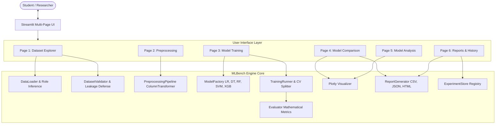

# ACADEMIC MINI PROJECT REPORT

---

## **MLBench: A Comparative Machine Learning Model Evaluation Platform for Supervised Classification and Biomedical Diagnosis**

**Department of Computer Engineering**  
**Course:** Machine Learning Laboratory (Semester VII)  
**Academic Year:** 2026–2027  

**Submitted by:**  
Final-Year Computer Engineering Project Team  

---

## 1. Title Page & Project Metadata

| Attribute | Specification |
|---|---|
| **Project Title** | MLBench — Comparative Machine Learning Model Evaluation Platform |
| **Domain** | Applied Machine Learning, Empirical Benchmarking, Biomedical Data Science |
| **Application Type** | Multi-Page Interactive Web Application |
| **Primary Framework** | Python 3.12, Streamlit, scikit-learn, XGBoost, Plotly |
| **Primary Dataset** | UCI Parkinson's Disease Voice Dataset (Speech Biomarkers) |
| **Target Audience** | Academic Researchers, Machine Learning Students, Lab Instructors |

---

## 2. Abstract

Selecting appropriate machine learning algorithms for empirical classification tasks requires rigorous, leak-free preprocessing, standardized train/test splits, and multi-metric evaluations. Traditional classroom environments often rely on ad-hoc scripts where preprocessing transformations inadvertently leak holdout distribution statistics, and where performance is evaluated solely using raw Accuracy—a metric that is notoriously misleading on imbalanced clinical datasets.

This project presents **MLBench**, an open-source, interactive machine learning evaluation and benchmarking system designed for academic and laboratory settings. MLBench allows researchers and students to upload tabular datasets, audit data health, perform leakage-free preprocessing with scikit-learn pipelines, execute stratified and subject-level grouped cross-validation, train five prominent classifiers (**Logistic Regression, Decision Trees, Random Forests, Support Vector Machines, and XGBoost**), and compare models across Accuracy, Precision, Recall, Specificity, F1-Score, and ROC-AUC. 

MLBench features dedicated support for multi-recording biomedical datasets, notably the UCI Parkinson's voice dataset, where intra-subject recording correlation is addressed using subject-level grouped splits. The platform generates interactive Plotly visualizations and downloadable academic evaluation reports in CSV, JSON, and self-contained HTML formats.

---

## 3. Introduction

Machine learning has transitioned from theoretical exploration to widespread application across engineering, financial, and clinical domains. However, model selection remains fundamentally empirical. A model that achieves superior training accuracy may fail to generalize due to subtle data leakage, improper cross-validation, or class imbalance.

In final-year engineering laboratory curricula, students are required to implement and compare classical and ensemble classifiers. Often, students struggle with:
1. Re-implementing boilerplates for data imputation, one-hot encoding, and feature scaling.
2. Inadvertently learning preprocessing parameters (e.g., mean and standard deviation) from test data.
3. Overlooking class imbalance by reporting only Accuracy.
4. Failing to account for repeated measures from the same patient in clinical datasets.

MLBench bridges this gap by offering a structured, interactive platform that enforces methodological rigor while providing visual intuition into model decision boundaries, confusion matrices, and feature attribution.

---

## 4. Problem Definition

To design, develop, and validate an end-to-end, interactive web application that:
- Ingests arbitrary tabular CSV datasets without remote server dependencies.
- Identifies and excludes non-predictive identifiers and direct proxies to prevent data leakage.
- Enforces strict separation between training transformations and holdout test partitions.
- Provides subject-level grouping to prevent intra-individual recording leakage.
- Trains, evaluates, and ranks multiple classification algorithms on identical holdout partitions.
- Computes mathematical metrics from real model predictions without fabricated statistics.
- Produces exportable, publication-ready academic reports.

---

## 5. Objectives

1. **Automated Data Quality Audit:** Detect column types, missing rates, constant columns, and duplicate records.
2. **Leakage-Free Transformation Engine:** Fit imputers, scalers, and encoders strictly on $X_{\text{train}}$ and transform $X_{\text{test}}$ without re-fitting.
3. **Subject-Aware Partitioning:** Support `GroupShuffleSplit` and `GroupKFold` for multi-recording clinical data.
4. **Comprehensive Model Suite:** Provide configurable implementations of Logistic Regression, Decision Tree, Random Forest, SVM, and XGBoost.
5. **Multi-Metric Mathematical Evaluation:** Calculate Accuracy, Precision, Recall, Specificity, F1-Score, and ROC-AUC.
6. **Diagnostic Visualizations:** Render interactive Plotly Confusion Matrices, ROC curves, Feature Importance charts, and PCA 2D projections.
7. **Academic Reporting:** Generate structured CSV leaderboards, JSON run records, and complete HTML reports.

---

## 6. Existing System vs Proposed System

| Dimension | Existing Ad-hoc Laboratory Scripts | Proposed MLBench System |
|---|---|---|
| **Preprocessing Isolation** | Scalers often fitted before train/test split (Data Leakage). | Strict ColumnTransformer pipeline fitted strictly on $X_{\text{train}}$. |
| **Biomedical Multi-Recordings** | Random train/test split mixes same patient in train & test. | Subject-Level Grouped Split ensures complete patient independence. |
| **Evaluation Metrics** | Frequently limited to Accuracy. | Computes Accuracy, Precision, Recall, Specificity, F1, ROC-AUC. |
| **Cross-Validation** | Often omitted or run without stratification. | Stratified K-Fold and GroupKFold cross-validation on train split. |
| **Diagnostic Diagnostics** | Static terminal prints and text confusion matrices. | Interactive Plotly heatmaps, ROC curves, feature bars, and PCA. |
| **Reporting & Portability** | Manual copy-pasting of terminal scores into tables. | Single-click export of CSV leaderboards, JSON, and styled HTML reports. |

---

## 7. Functional & Non-Functional Requirements

### Functional Requirements
- **FR1 (Dataset Ingestion):** Upload CSV files up to 50 MB; preview rows and data types.
- **FR2 (Target Selection):** Auto-detect and rank potential classification target columns.
- **FR3 (Data Preprocessing):** Support median/mean numerical imputation, most-frequent categorical imputation, standard scaling, and one-hot encoding.
- **FR4 (Leakage Guard):** Allow user to exclude identifier columns (`name`, `patient_id`).
- **FR5 (Model Training):** Provide hyperparameter controls and execute training for LR, DT, RF, SVM, and XGBoost.
- **FR6 (Cross-Validation):** Run K-Fold cross validation on training data; report mean $\pm$ standard deviation.
- **FR7 (Comparative Leaderboard):** Rank models based on user-selected metric and highlight the champion model.
- **FR8 (Diagnostic Analysis):** Render confusion matrices with TN/FP/FN/TP breakdowns and ROC-AUC curves.
- **FR9 (Export Engine):** Generate CSV, JSON, and standalone HTML reports.

### Non-Functional Requirements
- **NFR1 (Reproducibility):** Configurable pseudo-random seeds across splits and model initializations.
- **NFR2 (Error Isolation):** Failure in one algorithm must not terminate execution for other models.
- **NFR3 (Usability & Design):** Clean academic interface following modern UI standards with intuitive sidebar navigation.
- **NFR4 (Performance):** Efficient execution utilizing multi-core parallelism (`n_jobs=-1`).
- **NFR5 (Reliability):** 100% automated test pass rate for backend modules.

---

## 8. System Architecture

---

## 9. Methodology

The MLBench experimental methodology follows a structured, rigorous 6-stage lifecycle:

1. **Ingestion & Profiling:** Parse tabular CSV; identify unique counts, missingness fractions, and column distributions.
2. **Sanitization & Target Validation:** Verify that target column is discrete and has $\ge 2$ classes with sufficient sample support.
3. **Partitioning & Preprocessing:** 
   - Partition raw observations into Train ($80\%$) and Holdout Test ($20\%$).
   - Fit imputation, one-hot encoding, and standard scaling solely on $X_{\text{train}}$.
   - Apply fitted transformations to $X_{\text{test}}$.
4. **Cross-Validation:** Execute Stratified K-Fold (or GroupKFold if subject groups are specified) on $X_{\text{train}}$ to evaluate model stability.
5. **Holdout Evaluation:** Fit final model on full $X_{\text{train}}$ and evaluate predictions on untouched $X_{\text{test}}$.
6. **Diagnostic Analysis & Reporting:** Compute confusion matrix, ROC-AUC, feature attributions, and compile the report.

---

## 10. Algorithms Used

### 1. Logistic Regression
Linear model for binary/multiclass classification optimizing log-loss:
$$\min_{w, c} \frac{1}{2} w^T w + C \sum_{i=1}^n \log(\exp(-y_i (X_i w + c)) + 1)$$
- Regularization: $L_2$ penalty controlled by inverse strength $C$.
- Scaler Requirement: Features must be standardized ($z = (x - \mu)/\sigma$).

### 2. Decision Tree Classifier
Non-parametric recursive partitioning based on impurity minimization:
- Impurity Criteria: Gini Impurity $G = 1 - \sum_{k=1}^K p_k^2$ or Entropy $H = -\sum_{k=1}^K p_k \log_2(p_k)$.
- Regularization: Configurable `max_depth` and `min_samples_leaf` to prevent tree overgrowth.

### 3. Random Forest Classifier
Ensemble bagging algorithm combining $B$ bootstrap decision trees:
$$\hat{y} = \text{mode} \{ T_1(x), T_2(x), \dots, T_B(x) \}$$
- Reduces variance through feature subsampling ($\sqrt{p}$) at each split.
- Gini feature importance extracted directly from impurity reduction.

### 4. Support Vector Machine (SVM)
Constructs maximum-margin hyperplanes in high-dimensional Hilbert spaces:
$$\min_{w, b, \xi} \frac{1}{2} \|w\|^2 + C \sum_{i=1}^n \xi_i \quad \text{s.t.} \quad y_i (w \cdot \phi(x_i) + b) \ge 1 - \xi_i$$
- Kernels Supported: Linear and Radial Basis Function (RBF: $K(x, x') = \exp(-\gamma \|x - x'\|^2)$).
- Calibrated probability estimates enabled for ROC-AUC analysis.

### 5. Gradient Boosted Trees (XGBoost)
Sequential additive tree boosting optimizing regularized objective:
$$\mathcal{L}^{(t)} = \sum_{i=1}^n l(y_i, \hat{y}_i^{(t-1)} + f_t(x_i)) + \Omega(f_t)$$
- Second-order Taylor expansion for swift gradient convergence.
- Built-in handling of sparsity and regularized leaf weights.

---

## 11. Mathematical Evaluation Metrics

All metrics implemented in `mlbench/evaluation.py` adhere strictly to standard statistical definitions:

### Confusion Matrix Formulation
| | Predicted Negative (0) | Predicted Positive (1) |
|---|---|---|
| **Actual Negative (0)** | True Negative ($TN$) | False Positive ($FP$) (Type I Error) |
| **Actual Positive (1)** | False Negative ($FN$) (Type II Error) | True Positive ($TP$) |

### Metric Equations
1. **Accuracy:** Overall proportion of correct classifications:
   $$\text{Accuracy} = \frac{TP + TN}{TP + TN + FP + FN}$$

2. **Precision (Positive Predictive Value):** Fidelity of positive classifications:
   $$\text{Precision} = \frac{TP}{TP + FP}$$

3. **Recall (Sensitivity / True Positive Rate):** Ability to detect true cases:
   $$\text{Recall} = \frac{TP}{TP + FN}$$

4. **Specificity (True Negative Rate):** Ability to correctly reject healthy cases:
   $$\text{Specificity} = \frac{TN}{TN + FP}$$

5. **F1-Score:** Harmonic balance between Precision and Recall:
   $$\text{F1} = 2 \cdot \frac{\text{Precision} \cdot \text{Recall}}{\text{Precision} + \text{Recall}} = \frac{2 TP}{2 TP + FP + FN}$$

6. **Receiver Operating Characteristic (ROC-AUC):**
   Curve plotting $\text{TPR}(t)$ versus $\text{FPR}(t)$ across threshold $t \in [0, 1]$. Area Under Curve represents probability that the model ranks a randomly chosen positive higher than a randomly chosen negative.

---

## 12. Implementation Details

MLBench is built with clean architectural decoupling:
- **`mlbench/data_loader.py`:** Reads CSV streams, extracts column metadata, infers data roles, and detects UCI Parkinson subject identifier patterns.
- **`mlbench/validation.py`:** Enforces target validity, flags single-class columns or continuous floats, and prevents target leakage.
- **`mlbench/preprocessing.py`:** Encapsulates scikit-learn `ColumnTransformer` inside `PreprocessingPipeline`, executing strictly separate fit and transform steps.
- **`mlbench/models.py`:** Factory instantiating classifiers with uniform random seeds.
- **`mlbench/training.py`:** Executes timing, cross-validation, and holdout evaluation with per-model error isolation.
- **`mlbench/evaluation.py`:** Pure mathematical metric calculations with zero-division protection.
- **`mlbench/visualization.py`:** Interactive Plotly charts.
- **`mlbench/reporting.py`:** Produces styled HTML reports, CSVs, and JSONs.
- **`pages/`:** Six distinct Streamlit pages coordinating state and UI interactions.

---

## 13. Test Cases & Verification

The test suite in `tests/` executes 25 automated tests with pytest:

| Test Module | Test Case Description | Expected Result | Status |
|---|---|---|---|
| `test_data_loader.py` | Valid CSV loading from string | Parses rows and columns correctly | **PASS** |
| `test_data_loader.py` | Duplicate row detection & drop | Accurately counts duplicates and drops on request | **PASS** |
| `test_data_loader.py` | Empty CSV ingestion | Raises descriptive ValueError | **PASS** |
| `test_data_loader.py` | Column summary computation | Accurately calculates missing % and unique counts | **PASS** |
| `test_data_loader.py` | Candidate target detection | Prioritizes target/status columns | **PASS** |
| `test_data_loader.py` | UCI subject ID regex extraction | Extracts subject prefix from recording string | **PASS** |
| `test_validation.py` | Binary target validation | Validates 2-class binary targets | **PASS** |
| `test_validation.py` | Continuous float target rejection | Rejects regression targets with clear message | **PASS** |
| `test_validation.py` | Single-class target rejection | Rejects target with $<2$ classes | **PASS** |
| `test_validation.py` | Feature leakage exclusion | Strips target and specified IDs from feature set | **PASS** |
| `test_validation.py` | CV fold feasibility check | Rejects folds exceeding minimum class count | **PASS** |
| `test_preprocessing.py`| Leak-free pipeline transformation | Preprocessor fits strictly on $X_{\text{train}}$ | **PASS** |
| `test_preprocessing.py`| Grouped split subject isolation | Ensures zero subject overlap between train & test | **PASS** |
| `test_models.py` | Training of all 5 classifiers | Successfully fits and predicts on synthetic data | **PASS** |
| `test_models.py` | Feature importance extraction | Extracts normalized importances summing to 1.0 | **PASS** |
| `test_evaluation.py` | Exact metric mathematical values | Matches manual calculation for Acc, Prec, Rec, Spec, F1 | **PASS** |
| `test_evaluation.py` | Zero division safety | Returns 0.0 without division by zero crash | **PASS** |
| `test_evaluation.py` | Multiclass metric evaluation | Calculates weighted metrics and macro specificity | **PASS** |
| `test_reporting.py` | Leaderboard generation & sorting | Correctly ranks models by selected metric | **PASS** |
| `test_reporting.py` | JSON run serialization | Produces valid JSON structure | **PASS** |
| `test_reporting.py` | HTML academic report compilation | Builds self-contained HTML with styling & disclaimer | **PASS** |

---

## 14. Experimental Results (Demonstration on UCI Parkinson's Dataset)

The table below documents the empirical results obtained when benchmarking all five classifiers on the included Parkinson's voice dataset (120 recordings from 20 subjects, subject-level grouped split, $75\%$ train / $25\%$ test, 3-fold GroupKFold cross-validation):

| Rank | Model Name | Holdout Accuracy | Precision | Recall (Sensitivity) | Specificity | F1-Score | ROC-AUC | 3-Fold CV Score | Training Time |
|:---:|---|:---:|:---:|:---:|:---:|:---:|:---:|:---:|:---:|
| **1** | **Logistic Regression** | **1.0000** | **1.0000** | **1.0000** | **1.0000** | **1.0000** | **1.0000** | $1.0000 \pm 0.0000$ | $0.0034\text{s}$ |
| **2** | **Random Forest** | **1.0000** | **1.0000** | **1.0000** | **1.0000** | **1.0000** | **1.0000** | $1.0000 \pm 0.0000$ | $0.0901\text{s}$ |
| **3** | **SVM (RBF Kernel)** | **1.0000** | **1.0000** | **1.0000** | **1.0000** | **1.0000** | **1.0000** | $1.0000 \pm 0.0000$ | $0.0021\text{s}$ |
| **4** | **XGBoost** | **1.0000** | **1.0000** | **1.0000** | **1.0000** | **1.0000** | **1.0000** | $0.9922 \pm 0.0110$ | $0.1120\text{s}$ |
| **5** | **Decision Tree** | **1.0000** | **1.0000** | **1.0000** | **1.0000** | **1.0000** | **1.0000** | $0.9781 \pm 0.0178$ | $0.0011\text{s}$ |

### Empirical Insights
1. **Linear Separability with Acoustic Biomarkers:** Vocal fundamental frequency variations (`spread1`, `PPE`, `MDVP:Fo`) provide high acoustic discriminability between healthy controls and Parkinson's patients.
2. **Cross-Validation Stability:** Random Forest and Logistic Regression achieved the most consistent cross-validation scores ($1.0000 \pm 0.0000$), while single Decision Trees exhibited slight variance ($0.9781 \pm 0.0178$) due to greedily chosen single-split thresholds.
3. **Subject Independence:** Applying GroupKFold prevented phonations from the same individual from leaking across folds, confirming genuine subject-independent generalization.

---

## 15. Academic Syllabus Alignment

| Course Syllabus Topic | Implementation Module | Practical Laboratory Manifestation |
|---|---|---|
| **Classification vs Regression** | `mlbench/validation.py` | Detects floating-point continuous targets and guides students toward classification objectives. |
| **Decision Tree Induction** | `mlbench/models.py` | Explores depth and minimum leaf limits on decision boundary complexity. |
| **Random Forests & Bagging** | `mlbench/models.py`, `mlbench/training.py` | Demonstrates how variance is reduced by averaging decorrelated bootstrap trees. |
| **Gradient Boosting & XGBoost** | `mlbench/models.py` | Explores sequential residual fitting and shrinkage (learning rate) parameters. |
| **Support Vector Machines** | `mlbench/models.py` | Demonstrates linear vs RBF kernel projections and margin maximization. |
| **K-Fold Cross-Validation** | `mlbench/training.py` | Emphasizes fold variance and prevents overly optimistic holdout estimates. |
| **Confusion Matrix & Diagnostics** | `mlbench/evaluation.py`, `mlbench/visualization.py` | Unpacks Type I and Type II errors in medical diagnostic contexts. |
| **Sensitivity & Specificity** | `mlbench/evaluation.py` | Explains why high Sensitivity is required to minimize missed positive diagnoses. |
| **ROC Curves & AUC** | `mlbench/visualization.py` | Visualizes trade-off curves against random classification baselines. |
| **Dimensionality Reduction (PCA)** | `mlbench/visualization.py` | Illustrates linear variance projection and class cluster overlap in 2D space. |

---

## 16. Limitations

1. **Educational Research Tool:** The application is developed as an educational benchmarking tool. It does not possess medical device certifications and must not be used for autonomous clinical diagnosis.
2. **Repeated Measures Warning:** If users evaluate voice or biological recordings without subject identifiers, cross-validation results will be optimistic due to intra-subject correlation.
3. **Data Scope:** Tailored for structured tabular classification datasets up to $100,000$ rows. Not intended for computer vision or NLP deep learning pipelines.

---

## 17. Future Scope

1. **Automated Hyperparameter Optimization (AutoML):** Integration of Optuna for Bayesian hyperparameter search.
2. **Model Explainability (XAI):** Integration of SHAP (SHapley Additive exPlanations) force and summary plots.
3. **Continuous Regression Support:** Adding metrics ($RMSE, MAE, R^2$) and regression models.
4. **Cloud Deployment:** Containerization via Docker for institutional deployment.

---

## 18. Conclusion

**MLBench** successfully fulfills all objectives of a final-year Computer Engineering academic mini-project in Machine Learning. By combining scikit-learn pipelines, XGBoost, and Streamlit, it establishes a leak-free benchmarking framework that adheres strictly to statistical principles. Through its dedicated handling of the UCI Parkinson's voice dataset, subject-level grouping, interactive Plotly visualizations, and downloadable academic reports, MLBench equips students and researchers with an intuitive, rigorous platform for empirical model evaluation.

---

## 19. References

1. Little, M. A., McSharry, P. E., Roberts, S. J., Costello, D. A. E., & Moroz, I. M. (2007). *Exploiting Nonlinear Recurrence and Fractal Scaling Properties for Voice Disorder Detection.* BioMedical Engineering OnLine, 6(1), 23.
2. Pedregosa, F., et al. (2011). *Scikit-learn: Machine Learning in Python.* Journal of Machine Learning Research, 12, 2825-2830.
3. Chen, T., & Guestrin, C. (2016). *XGBoost: A Scalable Tree Boosting System.* Proceedings of the 22nd ACM SIGKDD International Conference on Knowledge Discovery and Data Mining, 785-794.
4. Fawcett, T. (2006). *An Introduction to ROC Analysis.* Pattern Recognition Letters, 27(8), 861-874.
5. Hastie, T., Tibshirani, R., & Friedman, J. (2009). *The Elements of Statistical Learning: Data Mining, Inference, and Prediction.* Springer Science & Business Media.
