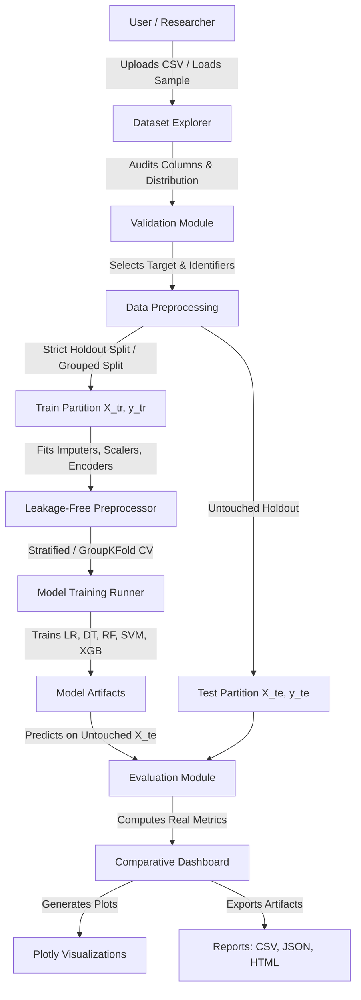

# MLBench — Comparative Machine Learning Model Evaluation Platform

**Academic Mini-Project for Final-Year Computer Engineering (Machine Learning)**

---

## 📌 Abstract

In contemporary data science and machine learning research, selecting an optimal classification algorithm for a given tabular dataset requires empirical evaluation under strict, leak-free conditions. **MLBench** is an interactive, production-quality web platform that enables data scientists and students to upload tabular CSV datasets, audit feature distributions and missingness, configure leakage-free preprocessing pipelines, train multiple classification models, evaluate their performance using standardized mathematical metrics, and compare the results through interactive dashboards and publication-grade reports. 

The platform implements five fundamental supervised classifiers: **Logistic Regression, Decision Trees, Random Forests, Support Vector Machines (SVM), and Gradient Boosted Trees (XGBoost)**. It features dedicated support for the biomedical **UCI Parkinson's Disease Voice Dataset**, including subject-level grouped cross-validation to mitigate intra-subject voice recording correlation.

---

## 📖 Introduction & Problem Statement

### Problem Statement
In academic laboratory curricula and practical machine learning applications, students and practitioners frequently face critical pitfalls:
1. **Data Leakage:** Fitting scalers and encoders across the entire dataset before splitting, resulting in overly optimistic generalization estimates.
2. **Evaluation Inconsistency:** Comparing models trained on divergent subsets, inconsistent metric implementations, or uncalibrated thresholds.
3. **Improper Multi-Recording Splitting:** Splitting repeated biomedical recordings (e.g., patient voice phonations) randomly instead of grouping by subject, allowing subject identity to leak into test partitions.
4. **Oversimplified Metrics:** Relying solely on raw Accuracy for class-imbalanced datasets rather than examining Precision, Recall, Specificity, F1-Score, and ROC-AUC.

### Proposed Solution: MLBench
MLBench provides a standardized, interactive framework that enforces leak-free transformations, transparent cross-validation, multi-metric benchmarking, diagnostic visualizations (Confusion Matrices, ROC Curves, Feature Importance, PCA), and downloadable academic reports in CSV, JSON, and HTML formats.

---

## 🎯 Objectives & Scope

### Core Objectives
- Enable CSV dataset ingestion with automated data type inference and quality alerts.
- Enforce strict separation between training transformations and holdout test partitions.
- Implement subject-level grouped cross-validation to prevent patient-level data leakage.
- Benchmark five core classifiers on identical holdout test sets.
- Compute mathematically rigorous metrics from real model predictions without fabrication.
- Generate interactive Plotly visualizations and downloadable evaluation reports.

### Scope
- **Domain:** Supervised classification on tabular data (Binary and Multiclass).
- **Target Audience:** Undergraduate Computer Engineering students, ML educators, and researchers.
- **Educational Scope:** Demonstrates core university syllabus topics (Decision Trees, Ensemble Learning, SVMs, Cross-Validation, and Diagnostic Metrics).

---

## 🛠️ Technology Stack

| Component | Technology | Version | Purpose |
|---|---|---|---|
| **Language** | Python | 3.11 / 3.12 | Core programming environment |
| **Framework** | Streamlit | ≥1.35.0 | Interactive web interface & multi-page navigation |
| **Machine Learning** | scikit-learn | ≥1.3.0 | Preprocessing pipelines, classical ML classifiers, metrics |
| **Gradient Boosting** | XGBoost | ≥2.0.0 | High-performance gradient-boosted decision trees |
| **Data Manipulation** | pandas | ≥2.0.0 | Tabular dataset manipulation, summaries, and transformations |
| **Numerical Computing** | NumPy | ≥1.24.0 | Vectorized numerical operations and matrix linear algebra |
| **Statistical Methods** | SciPy | ≥1.10.0 | Statistical calculations and distributions |
| **Visualizations** | Plotly | ≥5.18.0 | Interactive web charts (ROC curves, heatmaps, bar charts, PCA) |
| **Testing** | pytest | ≥7.4.0 | Automated unit and integration test suite |
| **Model Persistence** | joblib | ≥1.3.0 | Serialization of trained pipeline artifacts |

---

## 🏛️ System Architecture



---

## 📂 Project Structure

```
mnp/
├── app.py                      # Home Dashboard & session coordinator
├── requirements.txt            # Dependency specifications
├── .gitignore                  # Git exclusions for environments & caches
├── README.md                   # Complete academic documentation & guide
├── PROJECT_REPORT.md           # Formal engineering project report
├── pages/                      # Multi-page Streamlit application modules
│   ├── 1_Dataset_Explorer.py   # Dataset preview, EDA, missingness, target selection
│   ├── 2_Preprocessing.py      # Imputation, scaling, encoding, grouped split
│   ├── 3_Model_Training.py     # Hyperparameters, K-fold CV, training execution
│   ├── 4_Model_Comparison.py   # Benchmark leaderboard, side-by-side comparison
│   ├── 5_Model_Analysis.py     # Confusion matrices, ROC-AUC, feature importance, PCA
│   └── 6_Reports.py            # CSV/JSON/HTML export, syllabus alignment
├── mlbench/                    # Core business logic & ML engine
│   ├── __init__.py             # Package declaration
│   ├── data_loader.py          # CSV ingestion, role inference, subject detection
│   ├── validation.py           # Target validation, feature validation, CV checks
│   ├── preprocessing.py        # ColumnTransformer, leakage-free pipelines, splits
│   ├── models.py               # Model factory (LR, DT, RF, SVM, XGBoost)
│   ├── training.py             # Runner, timing, cross-validation, error isolation
│   ├── evaluation.py           # Mathematical metric calculations & classification reports
│   ├── visualization.py        # Plotly chart builders
│   ├── reporting.py            # CSV, JSON, and HTML report generators
│   ├── experiment_store.py     # Run registry & session comparison
│   └── state.py                # Streamlit session state initializer & styles
├── tests/                      # Automated pytest suite
│   ├── test_data_loader.py     # Ingestion & metadata extraction tests
│   ├── test_validation.py      # Target & leakage validation tests
│   ├── test_preprocessing.py   # Leak-free transformer & split tests
│   ├── test_models.py          # Classifier training & importance tests
│   ├── test_evaluation.py      # Metric formula & zero-division tests
│   └── test_reporting.py       # Leaderboard & report export tests
└── sample_data/                # Sample datasets for laboratory demos
    ├── parkinsons_sample.csv   # UCI Parkinson voice dataset sample (120 rows)
    └── README.md               # Dataset dictionary and experimental notes
```

---

## 🚀 Setup & Execution Instructions

### Prerequisites
- Python 3.11 or 3.12 installed on your operating system.
- Git (optional, for version tracking).

### 1. Clone or Navigate to Project Directory
```powershell
cd "c:\Notes\SEM 7\ML\mnp"
```

### 2. (Optional) Create and Activate Virtual Environment
```powershell
python -m venv venv
.\venv\Scripts\Activate.ps1
```

### 3. Install Dependencies
```powershell
pip install -r requirements.txt
```

### 4. Run Automated Test Suite
Verify that all unit and integration tests pass:
```powershell
python -m pytest -v
```

### 5. Launch MLBench Web Application
```powershell
streamlit run app.py
```
Upon execution, your default browser will open automatically at `http://localhost:8501`.

---

## 🔬 Parkinson's Disease Dataset Demonstration Workflow

MLBench includes an out-of-the-box laboratory demonstration using the **UCI Parkinson's Disease Voice Dataset**:

1. **Launch App:** Navigate to `http://localhost:8501`.
2. **Instant Load:** On the Home Dashboard, click the **📁 Load Parkinson's Dataset Example** button.
3. **Inspect (Page 1):** In *Dataset Explorer*, observe:
   - 120 phonation observations across 24 columns.
   - Column `status`: 1 (Parkinson's Disease), 0 (Healthy Controls).
   - Inferred target: `status`.
4. **Preprocess (Page 2):** In *Data Preprocessing*:
   - Confirm `name` is excluded from predictive features (identifier).
   - Enable **Subject-Level Grouped Split** using `name` to prevent intra-patient correlation leakage.
   - Click **Execute Preprocessing**.
5. **Train (Page 3):** In *Model Training*:
   - Keep all 5 algorithms checked (Logistic Regression, Decision Tree, Random Forest, SVM, XGBoost).
   - Enable 5-Fold Cross-Validation.
   - Click **Start Training All Selected Models**.
6. **Compare & Analyze (Pages 4 & 5):**
   - Review the Leaderboard ranked by F1-Score.
   - Inspect the Confusion Matrix and ROC curve.
   - View top predictive features (e.g., `spread1`, `PPE`, `MDVP:Fo(Hz)`).
7. **Export (Page 6):** Download the complete academic **HTML Evaluation Report**.

---

## 📐 Mathematical Evaluation Metrics

All metrics are computed strictly from real predictions on the holdout test set:

1. **Accuracy:**
   $$\text{Accuracy} = \frac{TP + TN}{TP + TN + FP + FN}$$

2. **Precision (Positive Predictive Value):**
   $$\text{Precision} = \frac{TP}{TP + FP}$$

3. **Recall (Sensitivity / True Positive Rate):**
   $$\text{Recall} = \frac{TP}{TP + FN}$$

4. **Specificity (True Negative Rate):**
   $$\text{Specificity} = \frac{TN}{TN + FP}$$

5. **F1-Score (Harmonic Mean):**
   $$\text{F1} = 2 \times \frac{\text{Precision} \times \text{Recall}}{\text{Precision} + \text{Recall}}$$

6. **ROC-AUC (Receiver Operating Characteristic - Area Under Curve):**
   Integral of the True Positive Rate against False Positive Rate across all discrimination thresholds:
   $$\text{AUC} = \int_{0}^{1} \text{TPR}(\text{FPR}^{-1}(t)) \, dt$$

---

## 🎓 Academic Syllabus Alignment Table

| Syllabus Curriculum Topic | Implementation File | Laboratory Demonstration Component |
|---|---|---|
| **Supervised Classification vs Regression** | `mlbench/validation.py` | Distinguishes continuous regression targets from classification labels; enforces class thresholds. |
| **Decision Tree Classifiers** | `mlbench/models.py` | `DecisionTreeClassifier` with customizable depth, min leaf size, and split criteria. |
| **Bagging & Random Forest** | `mlbench/models.py`, `mlbench/training.py` | `RandomForestClassifier` ensemble with tree counts and Gini impurity feature importance. |
| **Gradient Boosting Machines** | `mlbench/models.py` | `XGBClassifier` with boosting rounds, learning rate, and shrinkage controls. |
| **Support Vector Machines (SVM)** | `mlbench/models.py` | `SVC` with Linear and RBF kernels, standard scaling, and probability calibration. |
| **K-Fold Cross-Validation** | `mlbench/training.py` | Stratified K-Fold and GroupKFold cross-validation exclusively on the training partition. |
| **Confusion Matrix Analysis** | `mlbench/evaluation.py`, `mlbench/visualization.py` | Exact computation of TP, TN, FP, FN with interactive heatmap visualizations. |
| **Sensitivity & Specificity** | `mlbench/evaluation.py` | Direct mathematical computation of TPR and TNR for medical diagnostic scenarios. |
| **Precision, Recall, F-Measure** | `mlbench/evaluation.py` | Evaluation of harmonic mean trade-offs under class-imbalanced conditions. |
| **ROC Curves & AUC** | `mlbench/evaluation.py`, `mlbench/visualization.py` | Interactive ROC curves with diagonal random chance baseline and multiclass OvR curves. |
| **Dimensionality Reduction (PCA)** | `mlbench/visualization.py` | 2D projection with explained variance ratios for exploring class separability. |

---

## ⚠️ Limitations & Educational Disclaimer

1. **Educational Research Tool:** MLBench is engineered as an educational laboratory platform for Computer Engineering students. It is **NOT** a certified clinical diagnostic system.
2. **Subject-Level Independence:** When evaluating repeated biomedical measurements (such as voice phonations), standard recording-level splits yield artificially inflated scores. Grouped cross-validation must be utilized.
3. **Tabular Scope:** The platform is optimized for structured tabular classification data and does not support unstructured image or raw audio waveform processing.

---

## 🔮 Future Enhancements
- Automated Hyperparameter Optimization via Bayesian Optimization (`Optuna`).
- Explainability via SHAP (SHapley Additive exPlanations) summary plots.
- Support for tabular regression metrics (RMSE, MAE, $R^2$).
- Export of serialized model artifacts (`.joblib`) with REST API inference wrappers.
